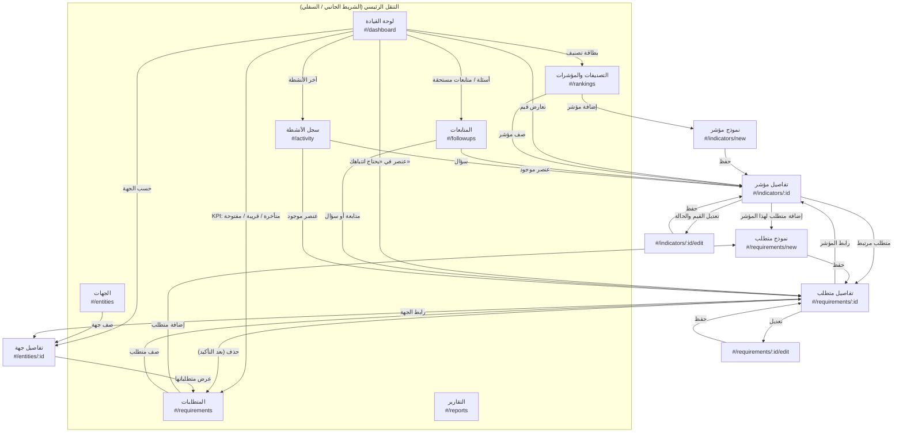
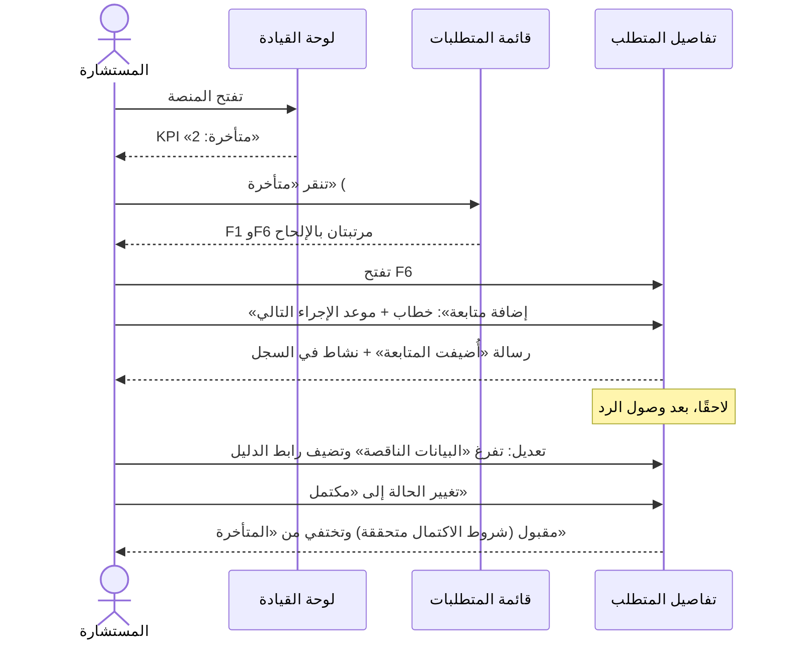

# 02 — خريطة التنقل والمسارات

> وثيقة تصميم. المخططات بصيغة Mermaid (تُعرض في GitHub وVS Code)، وتحت كل مخطط جدول نصي بالمعلومات نفسها لمن لا يظهر عنده المخطط.

## 1. لماذا مسارات `#/...`؟
التطبيق صفحة واحدة `index.html` تُفتح عبر `file://`. التنقل بتغيير الجزء بعد `#` يعمل دون خادم، ويدعم زرَّي الرجوع والتقدم في المتصفح، ويسمح بمشاركة رابط بحالة تصفية محددة (مثل الانتقال من لوحة القيادة إلى «المتأخرة»). أي مسار غير معروف يعيد إلى `#/dashboard` برسالة «الصفحة غير موجودة».

## 2. المسارات

| المسار | الصفحة | المعاملات |
|---|---|---|
| `#/dashboard` | لوحة القيادة (الافتراضية) | — |
| `#/rankings` | التصنيفات والمؤشرات | `?ranking=ARAB\|QS`، و`&work=draft…`، و`&conflict=1` |
| `#/indicators/:id` | تفاصيل مؤشر | — |
| `#/indicators/:id/edit` | تعديل القيم والحالة | — |
| `#/indicators/new` | إضافة مؤشر | `?ranking=` |
| `#/requirements` | قائمة المتطلبات | `?q=`، و`ranking=`، و`indicator=`، و`entity=`، و`status=`، و`priority=`، و`due=overdue\|soon`، و`sort=` |
| `#/requirements/new` | إضافة متطلب | `?indicator=` (تعبئة مسبقة) |
| `#/requirements/:id` | تفاصيل متطلب + متابعاته | — |
| `#/requirements/:id/edit` | تعديل متطلب | — |
| `#/entities` | الجهات | — |
| `#/entities/:id` | تفاصيل جهة | — |
| `#/followups` | المتابعات | `?tab=due\|all\|decisions` |
| `#/reports` | التقارير | `?type=meeting\|summary\|overdue\|entity&ranking=&domain=` |
| `#/activity` | سجل الأنشطة | `?action=&type=` |

## 3. الخريطة العامة

**النسخة النصية:** من كل صفحة يمكن الوصول إلى الصفحات السبع عبر التنقل الرئيسي. أهم الانتقالات الداخلية:
- **لوحة القيادة ←** المتطلبات المصفاة، وتفاصيل متطلب، وتفاصيل مؤشر، والمتابعات، والجهة، والسجل.
- **المؤشر ↔ المتطلب:** في الاتجاهين.
- **المتطلب ← الجهة ←** متطلبات الجهة.
- **النماذج:** «حفظ» يعود إلى صفحة التفاصيل، و«إلغاء» يعود إلى الصفحة السابقة.

## 4. التدفق الأهم: من «متأخر» إلى إغلاق المتطلب

## 5. التنقل حسب حجم الشاشة

| العرض | التنقل | الجداول | النماذج |
|---|---|---|---|
| ≥ 1024px (حاسوب) | شريط جانبي ثابت **يمين** الشاشة بعرض 240px، بأيقونة ونص | جداول كاملة | عمودان للحقول القصيرة |
| 640–1023px (لوحي) | شريط جانبي مطوي إلى أيقونات (72px)، وتظهر الأسماء عند التمرير أو التركيز، وزر لتوسيعه | جداول مع إخفاء الأعمدة الثانوية (العام الماضي، آخر متابعة) | عمود واحد |
| < 640px (جوال) | شريط سفلي ثابت بخمسة عناصر: القيادة · المؤشرات · المتطلبات · المتابعات · المزيد | **بطاقات** بدل الجداول | عمود واحد، وأزرار الحفظ بعرض الشاشة ثابتة أسفلها |

## 6. لوحة المفاتيح وإمكانية الوصول
- ترتيب Tab يتبع الترتيب البصري من اليمين لليسار: التنقل، ثم المحتوى، ثم الإجراءات.
- رابط «انتقل إلى المحتوى» أول عنصر في الصفحة.
- عند تغيير الصفحة يُنقل التركيز إلى عنوانها (`h1` مع `tabindex="-1"`)، ويُحدَّث `document.title`.
- الحوارات تحبس التركيز داخلها، و`Esc` يغلقها ويعيد التركيز إلى الزر الذي فتحها.
- الصفحة الحالية في التنقل عليها `aria-current="page"`.
