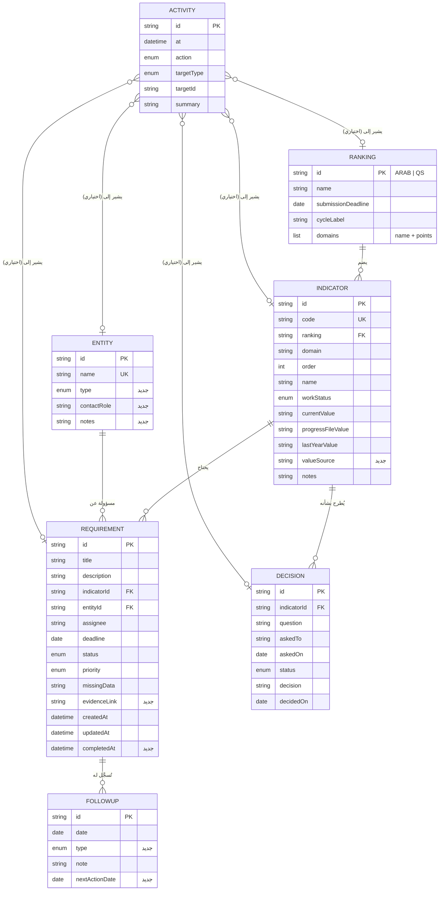

# 03 — نموذج البيانات والعلاقات

> وثيقة تصميم. يصف **الإصدار 2 من البنية (`schemaVersion: 2`)** المقترح لدعم صفحات المرحلة الثانية، وطريقة الترقية من الإصدار 1 المنفذ في المرحلة الأولى. **لم يُنفذ شيء منه بعد.**

## 1. مخطط الكيانات والعلاقات



**النسخة النصية للعلاقات:**
- التصنيف 1 ← ن مؤشرات. المؤشر 1 ← ن متطلبات، و1 ← ن أسئلة وقرارات.
- الجهة 1 ← ن متطلبات. المتطلب 1 ← ن متابعات، والمتابعات **مخزنة داخل المتطلب** (`followUps`) لأنها لا توجد دونه.
- النشاط يشير اختياريًا إلى عنصر واحد بنوعه ومعرّفه، ويبقى بعد حذف العنصر (الرابط يصبح «محذوف»).

## 2. شكل الملف المخزَّن (الإصدار 2)

```text
{
  schemaVersion: 2,
  isSample: true | false,
  rankings:     [Ranking],
  entities:     [Entity],
  indicators:   [Indicator],
  requirements: [Requirement { ..., followUps: [FollowUp] }],
  decisions:    [Decision],
  activities:   [Activity]        // الأحدث أولًا، بحد أقصى 500
}
```

## 3. القيم المسموحة (Enums)

| الحقل | القيم (المخزنة ← المعروضة) |
|---|---|
| `Indicator.workStatus` | `not_started` لم يبدأ · `draft` مسودة · `evidenced` محسوب بالأدلة · `entered` مُدخل في المنصة |
| `Requirement.status` | `new` جديد · `in_progress` قيد التنفيذ · `waiting` بانتظار الجهة · `done` مكتمل |
| `Requirement.priority` | `high` عالية · `medium` متوسطة · `low` منخفضة |
| `FollowUp.type` | `call` اتصال · `letter` خطاب · `meeting` اجتماع · `email` بريد · `other` أخرى |
| `Entity.type` | `deanship` عمادة · `vice_presidency` وكالة · `department` إدارة · `unit` وحدة · `college` كلية · `other` أخرى |
| `Decision.status` | `open` مفتوح · `resolved` محسوم |
| `Activity.action` | `create` · `update` · `delete` · `status_change` · `followup_add` · `decision_resolve` · `import` · `export` · `reset` |
| `Activity.targetType` | `ranking` · `indicator` · `requirement` · `entity` · `decision` · `data` |

## 4. الحقول المشتقة (تُحسب ولا تُخزن)

| الحقل | التعريف |
|---|---|
| متأخر، وقريب الموعد، والأيام | C-OVERDUE، C-DUESOON، C-DAYS في [04](04-rules-and-calculations.md) |
| تعارض القيم | R-CONFLICT (`hasValueConflict` المنفذة في المرحلة 1) |
| نسب الإنجاز والجاهزية | C-REQ-PROGRESS، C-IND-PROGRESS، C-ENT-PROGRESS |
| آخر متابعة | أحدث `followUps[].date` |
| متابعة مستحقة | C-FUP-DUE |

لا يُخزَّن «متأخر» حتى لا يصبح قديمًا عند تغير التاريخ.

## 5. الترقية من الإصدار 1 إلى 2

المرحلة الأولى نفذت الإصدار 1. الترقية **تلقائية وآمنة** عند التحميل أو الاستيراد:

| الإضافة | القيمة الافتراضية عند الترقية |
|---|---|
| `rankings` | يُنشأ من رموز التصنيفات الموجودة: `ARAB` («التصنيف العربي»، ومعيار «التعليم والتعلم» 300 نقطة) و`QS`، بموعد تسليم **فارغ** يظهر «لم يُحدد» حتى تُدخله المستخدمة |
| `Indicator.valueSource` | `''` |
| `Requirement.evidenceLink` | `''` |
| `Requirement.completedAt` | `updatedAt` إذا كانت الحالة `done`، وإلا `''` |
| `FollowUp.type` / `nextActionDate` | `other` / `''` |
| `Entity.type` / `contactRole` / `notes` | `unit` / `''` / `''` |
| `activities` | `[]` |

- بعد الترقية يصبح `schemaVersion = 2`، ولا يُحذف أي حقل قديم.
- ملف نسخة احتياطية من الإصدار 1 يُقبل في الاستيراد ويُرقّى. أي إصدار أعلى من 2 يُرفض برسالة.
- **أثر ذلك على الكود الحالي (عند التنفيذ):** `validateDataset` يقبل الإصدارين 1 و2 بعد الترقية، وتُضاف دالة `migrate` مع فحوص لها. فحوص المرحلة 1 التي تتوقع `schemaVersion: 1` تُحدَّث صراحة وتُوثَّق في `TEST_LOG.md`.

## 6. البيانات الوهمية بعد الترقية (مقترح يحتاج موافقة لأنه تعديل لـ `sample-data.js`)
- إضافة `rankings` بمواعيد **وهمية**: العربي `2026-11-10`، وQS `2026-12-27`، فيكون الباقي عند التاريخ المرجعي 2026-11-01: 9 أيام للعربي و56 يومًا لـ QS. المواعيد الحقيقية تُدخلها المستخدمة من الواجهة.
- بقية سجلات F1–F6 وI1/I6/I8/IQ وD1 **لا تتغير**، فلا تتأثر حالات القبول الحالية.
- لا روابط أدلة في البيانات الوهمية، حتى يبقى فحص AC-SEC-03 «لا روابط» صحيحًا كما هو.

## 7. المعرّفات والطوابع الزمنية
- المعرّف: بادئة النوع + وقت الإنشاء بالأساس 36 + 4 أحرف عشوائية (مثل `req-lz8k2m-a9f3`). في الفحوص تُحقن دالة توليد ثابتة.
- `createdAt` و`updatedAt` و`Activity.at` بصيغة ISO بالتوقيت العالمي. التواريخ التي تكتبها المستخدمة (الموعد، والمتابعة، والقرار) بصيغة `YYYY-MM-DD` دون وقت، لتجنب انزياح المنطقة الزمنية.

## 8. السعة
`localStorage` يتسع لنحو 5MB لكل موقع. التقدير: 500 متطلب × ~1KB + 500 نشاط × ~0.3KB ≈ 0.65MB، وهذا ضمن الحد بفارق كبير. إذا فشل الحفظ لامتلاء المساحة تظهر رسالة «تعذر الحفظ» (منفذة في المرحلة 1) مع اقتراح تصدير نسخة احتياطية.
